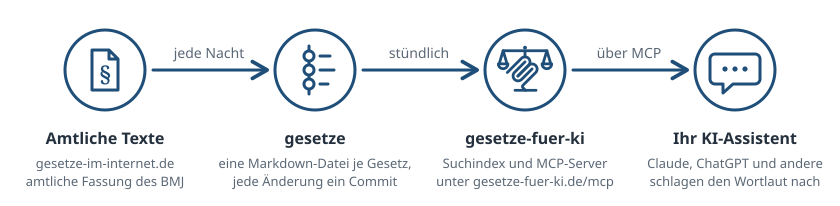

<p align="center">
  <picture>
    <source media="(prefers-color-scheme: dark)" srcset=".github/readme/logo-dunkel.svg">
    
  </picture>
</p>

<h1 align="center"><a href="https://gesetze-fuer-ki.de">Gesetze für KI</a></h1>

<p align="center">
  <a href="https://gesetze-fuer-ki.de/"></a>
  <a href="https://github.com/Gesetze-fuer-KI/gesetze-fuer-ki/actions/workflows/tests.yml"></a>
  <a href="https://github.com/Gesetze-fuer-KI/gesetze-fuer-ki/pkgs/container/gesetze-fuer-ki"></a>
  <a href="https://liberapay.com/GesetzeFuerKI"></a>
  <a href="LICENSE"></a>
</p>

<p align="center"><b>Der MCP-Server hinter gesetze-fuer-ki.de: das aktuelle Bundesrecht für KI-Assistenten.</b></p>

Claude, ChatGPT und andere KI-Assistenten schlagen über diesen Server den Wortlaut von rund 6.100 Gesetzen und Verordnungen nach, statt aus dem Gedächtnis zu zitieren. Ohne Anmeldung, ohne Schlüssel:

```text
https://gesetze-fuer-ki.de/mcp
```

## Loslegen

| | |
|---|---|
| **[Verbinden](https://gesetze-fuer-ki.de/verbinden/)** | Schritt für Schritt für [Claude](https://gesetze-fuer-ki.de/verbinden/#claude-claudeai-desktop-und-mobil), [ChatGPT](https://gesetze-fuer-ki.de/verbinden/#chatgpt), [Claude Code](https://gesetze-fuer-ki.de/verbinden/#claude-code), Cursor, VS Code, Gemini CLI, Codex und [weitere](https://gesetze-fuer-ki.de/verbinden/#weitere-assistenten) |
| **[Werkzeuge](https://gesetze-fuer-ki.de/werkzeuge/)** | Was der Assistent damit kann, [wie die Suche funktioniert](https://gesetze-fuer-ki.de/werkzeuge/#wie-die-suche-funktioniert) und wie man [frühere Fassungen](https://gesetze-fuer-ki.de/werkzeuge/#fruhere-fassungen) abruft |
| **[Daten und Grenzen](https://gesetze-fuer-ki.de/daten/)** | [Woher die Texte kommen](https://gesetze-fuer-ki.de/daten/#woher-die-texte-kommen) und [was nicht enthalten ist](https://gesetze-fuer-ki.de/daten/#was-nicht-enthalten-ist), etwa Landesrecht und Urteile |
| **[Unterstützen](https://gesetze-fuer-ki.de/unterstuetzen/)** | Der Dienst ist kostenlos und wird privat betrieben |

## So funktioniert es

<picture>
  <source media="(prefers-color-scheme: dark)" srcset=".github/readme/ablauf-dunkel.svg">
  
</picture>

Dieses Repository enthält den Server ([`app/`](app/)) und die Webseite ([`docs/`](docs/)). Die Gesetzestexte selbst liegen in **[Gesetze-fuer-KI/gesetze](https://github.com/Gesetze-fuer-KI/gesetze)**; mehr zur Herkunft auf **[Daten und Grenzen](https://gesetze-fuer-ki.de/daten/)**.

## Selbst betreiben

```yaml
services:
  gesetze-fuer-ki:
    image: ghcr.io/gesetze-fuer-ki/gesetze-fuer-ki:0.1.4
    restart: unless-stopped
    volumes:
      - ./data:/data
    ports:
      - "8081:8081"
```

Beim ersten Start klont und indiziert der Server etwa eine Minute lang, danach meldet `/health` `"ready": true`. Er braucht etwa 200 MB Arbeitsspeicher und 600 MB Platz. Einstellbar über Umgebungsvariablen: `GESETZE_REPO_URL`, `GESETZE_REPO_BRANCH`, `REFRESH_SECONDS` (Standard 3600), `DATA_DIR`, `ALLOWED_HOSTS`, `PORT` (Standard 8081).

## Entwicklung

```bash
cd app && uv sync --all-groups && uv run pytest -q
```

Weitere Befehle stehen in [`CLAUDE.md`](CLAUDE.md). Code und Kommentare sind Englisch, alles, was Nutzer sehen, ist Deutsch. Fehler und Wünsche bitte als [Issue](https://github.com/Gesetze-fuer-KI/gesetze-fuer-ki/issues).

## Lizenz

[AGPL-3.0 oder später](LICENSE), © 2026 Marcel Bruckner. Die Gesetzestexte selbst sind gemeinfrei (§ 5 UrhG).

---

<sub>Keine Rechtsberatung: Der Dienst liefert Gesetzestexte; maßgeblich ist die amtliche Fassung. · [Impressum](https://gesetze-fuer-ki.de/impressum/) · [Datenschutz](https://gesetze-fuer-ki.de/datenschutz/)</sub>
